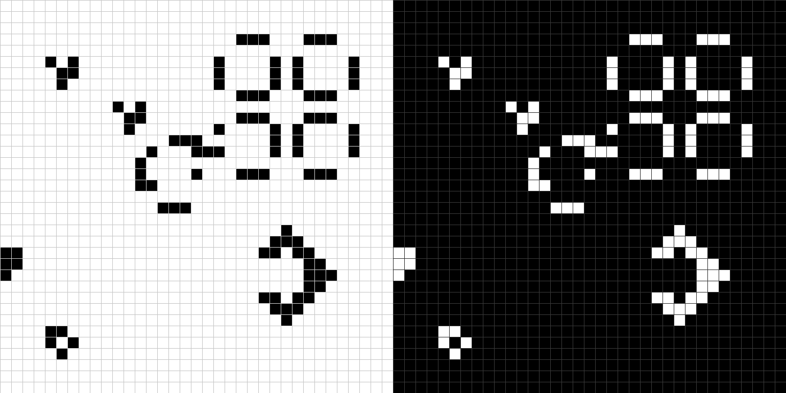

# Conway's Game of Life



Fork of https://github.com/855309/gameoflife.git

Infinite, sparse grid with time-travel.

## Dependencies
- SFML 3 (graphics, window, system)

## Compile
```
g++ -o gameoflife main.cpp -lsfml-graphics -lsfml-window -lsfml-system
```

## Controls
- Left click / drag: paint or erase cells
- Space: play / pause forward
- Z: play / pause reverse (stops at where you drew; can't use while going forward)
- C: clear grid
- Tab: fast forward (hold)
- Arrows: scroll canvas
- `--dark`: dark mode
